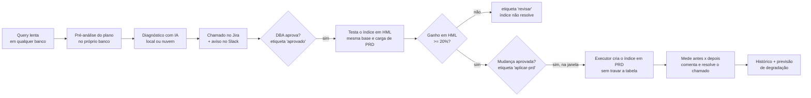
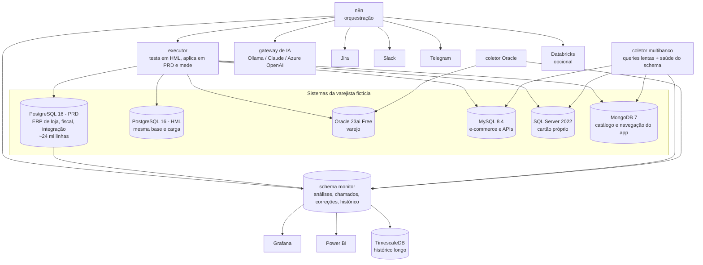
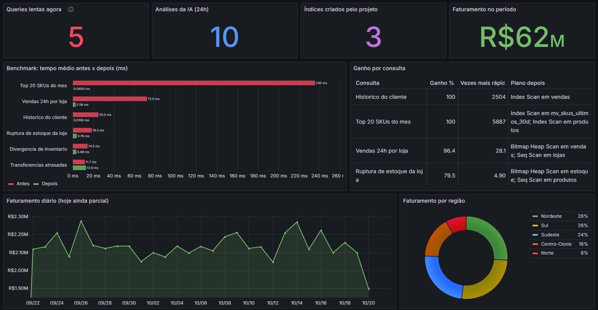

# monitor-db-ia

Monitoramento de bancos de dados com IA, do alerta à correção comprovada.

O lab acompanha os sistemas de uma varejista de moda fictícia, cada um no seu banco: **PostgreSQL**,
**Oracle**, **MySQL**, **SQL Server** e **MongoDB**. Ele detecta as queries lentas, gera o diagnóstico
com IA, abre o chamado no **Jira** e avisa o time no **Slack**. Depois que o DBA aprova, testa o índice
em **HML**, mede o ganho e só leva para **PRD** o que funcionou, com mudança aprovada e na janela.
O histórico alimenta uma previsão de quais queries vão passar do limite nas próximas semanas.

> Base 100% fictícia (varejo de moda genérico). Por padrão a IA roda localmente e nenhum dado sai da máquina.


## O ciclo



## Arquitetura



| Componente | Papel |
|---|---|
| PostgreSQL 16 (PRD) | ERP de loja e CD, fiscal (NFC-e/NF-e e SEFAZ) e fila de integração loja -> central; schemas `monitor` e `bi` |
| PostgreSQL 16 (HML / DEV) | Cópias da base. HML recebe a mesma carga de PRD e é onde a correção é testada |
| Oracle 23ai Free | Varejo em Oracle, monitorado pelo `V$SQL` e `DBMS_XPLAN` |
| MySQL 8.4 | E-commerce e APIs do app (pedidos, retira em loja, pagamentos, rastreio), lido pelo `performance_schema` |
| SQL Server 2022 | Cartão próprio e crediário (transações, faturas, cobrança), lido pelas DMVs e pelo plano XML |
| MongoDB 7 | Catálogo, avaliações e navegação do app, lido pelo profiler |
| Coletores (Python) | Leem o top lento de cada banco, geram plano e pistas e a saúde do schema |
| Gateway de IA | Mesmo formato do Ollama; troca entre Ollama local, Claude e Azure OpenAI pelo `.env` |
| n8n | Orquestra análise, alertas, chamados, correções e exportação |
| Executor (Python) | Testa a correção em HML, aplica em PRD só se liberada e mede o ganho real, nos cinco bancos |
| Jira / Slack / Telegram | Fila de chamados, aprovação e avisos |
| Grafana / Power BI | Painel operacional e relatório gerencial |
| TimescaleDB (opcional) | Histórico de longo prazo com compressão, retenção e agregado diário |
| Databricks (opcional) | Mesma previsão, para quem já usa a plataforma |

## A base de varejo

Modelo genérico de uma varejista de moda de grande porte, com volume ajustável (`ESCALA_BASE`):

| Banco | Sistema | Principais tabelas | Volume (escala 1) |
|---|---|---|---|
| PostgreSQL | ERP de loja e CD | vendas, itens, estoque, kardex, transferências, inventário, pedidos de compra, trocas | ~12 mi |
| PostgreSQL | Fiscal | notas (NFC-e e NF-e), itens da nota, eventos na SEFAZ (contingência e rejeição) | ~8,5 mi |
| PostgreSQL | Integração | fila loja -> central com lojas acumulando atraso e erros | 3 mi |
| MySQL | E-commerce | clientes do app, pedidos, itens, pagamentos, rastreio, carrinhos | ~7 mi |
| SQL Server | Cartão próprio | contas, cartões, transações, faturas, pagamentos, régua de cobrança | ~7,5 mi |
| MongoDB | App | catálogo, eventos de navegação, avaliações, listas de desejo | ~2,7 mi |

Cada sistema tem a sua carga simulada, com consultas do dia a dia (kardex no balcão, nota pela chave,
fila de integração parada, retira em loja atrasado, extrato do cartão, régua de cobrança, vistos
recentemente no app). Índices só nas chaves primárias, de propósito, para gerar o que o monitor resolve.
Também há problemas de schema plantados (índice duplicado, índice sem uso, tabela sem PK).

## Ambientes DEV / HML / PRD

Os ambientes ficam cadastrados em `monitor.ambientes`. Senhas não vão para a tabela.

| Ambiente | Papel no lab |
|---|---|
| **PRD** | Onde as queries lentas são coletadas. Só recebe correção testada em HML e com mudança aprovada |
| **HML** | Mesma base e mesma carga de PRD. A correção aprovada é criada e medida aqui primeiro |
| **DEV** | Só a base. Sem coleta e sem correção automática |

1. **`aprovado`** (DBA): o fluxo `testar-hml` confere a paridade HML x PRD, mede a query em HML, cria o índice
   e mede de novo. Com ganho de pelo menos `GANHO_MIN_PCT` (padrão 20%), o chamado ganha `liberado-prd`.
   Sem ganho, ganha `revisar` e nada vai para PRD.
2. **`aplicar-prd`** (mudança aprovada): o fluxo `aplicar-correcoes` cria o índice em PRD, mede e resolve o chamado.
   O executor recusa o que não foi liberado em HML e respeita a `JANELA_PRD` (ex.: `22:00-06:00`).

**Paridade:** antes de testar, o executor compara HML e PRD nas tabelas envolvidas (linhas e índices).
Se o HML não for parecido com PRD, o plano muda e o teste engana; os avisos vão no comentário do Jira.
A `monitor.vw_esteira` mostra cada chamado com o ganho em HML, o ganho em PRD e a etapa.

No lab, o HML existe para o PostgreSQL. Nos outros bancos o teste é dispensado e o comentário avisa.

## Por que a IA acerta

Um modelo pequeno, sozinho, sugere índices inúteis. Aqui a IA não adivinha:

1. O próprio banco lê o plano e aponta a leitura completa em tabela grande e as colunas de filtro sem
   índice: Seq Scan (PostgreSQL), TABLE ACCESS FULL (Oracle), `access_type ALL` (MySQL),
   Clustered Index Scan e o índice que o próprio otimizador pede (SQL Server), COLLSCAN com a regra
   igualdade-ordenação-faixa (MongoDB).
2. A IA recebe essas pistas como verdade e só explica, justifica e avalia o risco.
3. O executor mede o ganho real em HML antes de levar para PRD, e de novo em PRD antes de resolver o chamado.

## Saúde do schema

A cada 30 minutos o coletor grava em `monitor.saude_schema`, para todos os bancos: índices sem uso,
índices duplicados, tabelas sem chave primária e as maiores tabelas. Aparece no Grafana e no Power BI.

## Previsão

Cada query recebe uma tendência (ms por dia, regressão linear) e o número de dias até passar de 150 ms,
o limite de prioridade ALTA. A previsão roda no próprio monitor (`monitor.vw_previsao`, painel no Grafana),
sem depender de ferramenta externa. Para histórico longo há o TimescaleDB (compressão, retenção de 400 dias
e agregado contínuo diário), e o Databricks continua como opção. Os dias anteriores à coleta real são
simulados e marcados como `SIMULADO`.

## IA plugável

Os fluxos do n8n falam com o `ia-gateway`, no formato do Ollama. Trocar a IA é uma linha no `.env`:

| `IA_PROVEDOR` | Onde roda | Observação |
|---|---|---|
| `ollama` (padrão) | No próprio lab, gratuito | Nenhum dado sai da máquina |
| `claude` | API da Anthropic | Melhor diagnóstico; query e plano vão para a API |
| `azure_openai` | Azure OpenAI | Para clientes que já homologaram a Azure |

## Resultados no lab

| Chamado | Banco | Antes | Depois | Ganho |
|---|---|---|---|---|
| MDB-2 (vendas das últimas 24h) | PostgreSQL | 53,8 ms | 1,6 ms | 97,1% |
| MDB-3 (divergência de inventário) | PostgreSQL | 26 ms | 0,05 ms | 99,8% |
| MDB-1 (top 20 SKUs do mês) | PostgreSQL | 198 ms | ~196 ms | ~1% (índice não resolve; ver abaixo) |
| MDB-7 (top SKUs) | Oracle | 51 ms | criado com `ONLINE` | - |

O MDB-1 é proposital no relato: o ganho medido mostra que índice não resolve essa query. A correção
certa foi de modelagem, uma tabela pré-agregada atualizada pelo n8n (235 ms para 0,04 ms).

Nos testes da base ampliada: rastreio de pedido no MySQL caiu de 981 ms para 0,4 ms; divergência de
inventário testada em HML com 75,7% de ganho e aplicada em PRD com 72,7%.

## Segurança

- Nada é aplicado sem aprovação do DBA no Jira, e nada chega a PRD sem passar por HML e por aprovação de mudança.
- Janela de mudança de PRD configurável (`JANELA_PRD`).
- Índices criados sem travar escrita: `CONCURRENTLY` (PostgreSQL), `ONLINE` (Oracle e SQL Server),
  `ALGORITHM=INPLACE, LOCK=NONE` (MySQL), build em segundo plano (MongoDB).
- O executor só existe na rede interna do Docker (sem porta publicada).
- Monitoramento com usuários somente leitura em todos os bancos; segredos no `.env` e nas credenciais do n8n.

## Como subir

O passo a passo completo, na ordem, está em [docs/aplicar-melhorias.md](docs/aplicar-melhorias.md).

| Perfil | Sobe |
|---|---|
| (nenhum) | PostgreSQL PRD, n8n, Ollama, gateway de IA, Grafana, executor |
| `carga` | Carga simulada no PostgreSQL |
| `hml` / `dev` | PostgreSQL de homologação (com carga) / desenvolvimento |
| `oracle` | Oracle, carga e coletor |
| `mysql` / `sqlserver` / `mongodb` | O banco, a carga e o coletor multibanco |
| `timescale` | TimescaleDB com o histórico longo |

```
cp .env.example .env        # defina as senhas
docker compose --profile carga --profile hml up -d
docker exec -it ollama ollama pull qwen2.5:3b
```

Na nuvem: [deploy/azure](deploy/azure/README.md) (VM com Docker criada por Bicep, acesso só pelo seu IP).

## Fluxos do n8n

| Fluxo | Frequência | O que faz |
|---|---|---|
| analisador-queries-ollama | 30 min | Top lentas do PostgreSQL + plano + pistas -> IA |
| analisador-queries-oracle | 30 min | O mesmo para o Oracle |
| analisador-queries-multibanco | 30 min | O mesmo para MySQL, SQL Server e MongoDB |
| alertas-telegram | 15 min | Envia os diagnósticos no Telegram |
| chamados-jira | 15 min | Abre o chamado no Jira e avisa no Slack com o link |
| sincronizar-jira | 15 min | Traz status e responsável do Jira para o banco |
| testar-hml | 5 min | Testa em HML as correções aprovadas e libera (ou não) para PRD |
| aplicar-correcoes | 5 min | Aplica em PRD as correções liberadas e com mudança aprovada, mede, comenta e resolve |
| atualizar-preagregados | 1 h | Atualiza a tabela pré-agregada de ranking de SKUs |
| exportar-databricks | 1 h | Snapshot de performance e envio ao Databricks (opcional) |

## Telas

| | |
|---|---|
|  |  |
|  |  |
|  |  |



## Estrutura

```
db/init/        PostgreSQL: base, base ampliada, monitor, pistas, benchmark, BI, chamados, Jira, Oracle,
                correções, histórico, ambientes, multibanco e previsão
db/mysql/       MySQL: e-commerce e usuário de monitoramento
db/sqlserver/   SQL Server: cartão próprio e usuário de monitoramento
db/mongodb/     MongoDB: app e usuário de monitoramento
oracle/init/    Oracle: base de varejo e usuário de monitoramento
scripts/        cargas, coletores, conectores multibanco, executor e gateway de IA
n8n/workflows/  fluxos do n8n (os com dados do ambiente ficam em local/, fora do Git)
grafana/        datasources e painéis provisionados
timescale/      histórico longo no TimescaleDB
databricks/     tabelas, previsão e painel (opcional)
deploy/azure/   VM na Azure (Bicep + cloud-init)
docs/           passo a passo, Power BI, roteiro de apresentação e imagens
```

## Próximos passos

- Alertas no Microsoft Teams, canal mais comum em clientes.
- HML também para Oracle, MySQL e SQL Server (no Oracle, com cópia das estatísticas de PRD via `DBMS_STATS`).
- Cassandra e DynamoDB em modo diagnóstico (partição grande, tombstones, throttling), sem correção automática.
- Piloto em homologação de cliente, com usuário de leitura e aprovação de segurança.
