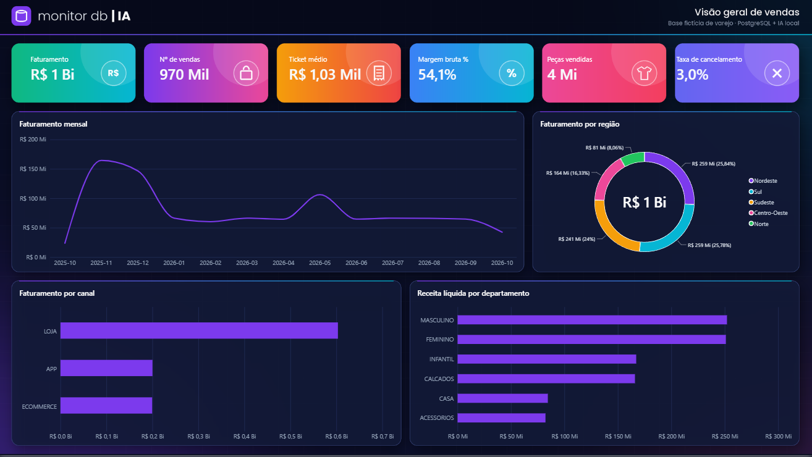
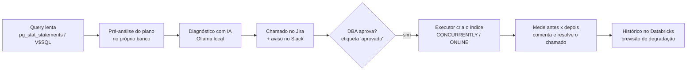
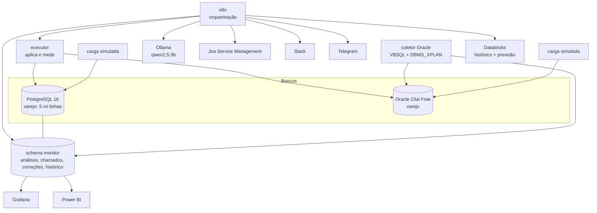
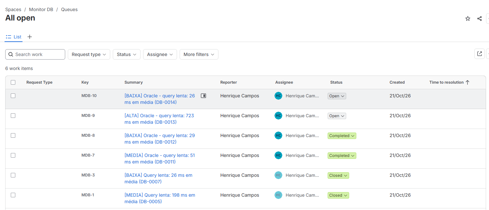
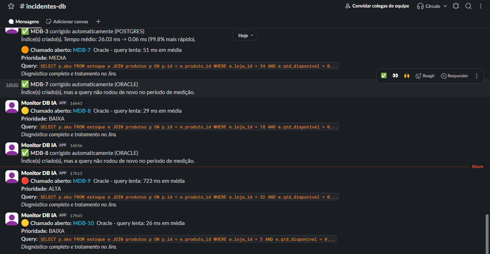
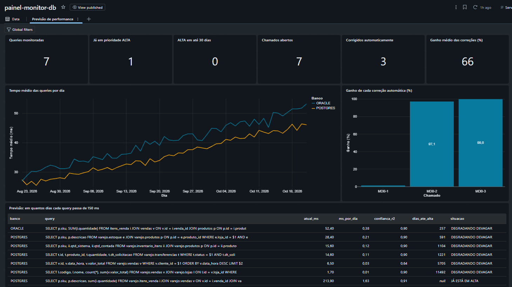
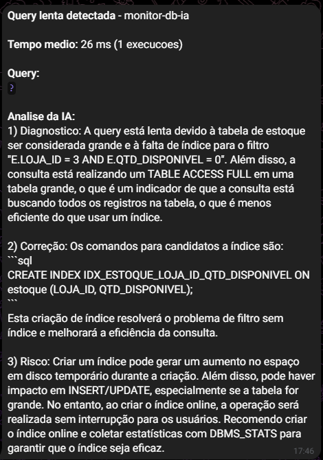
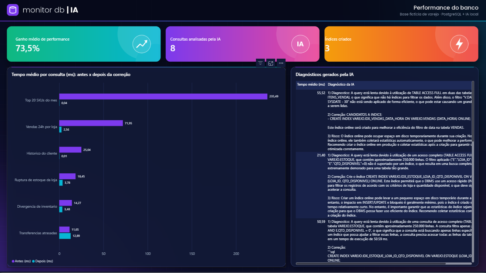
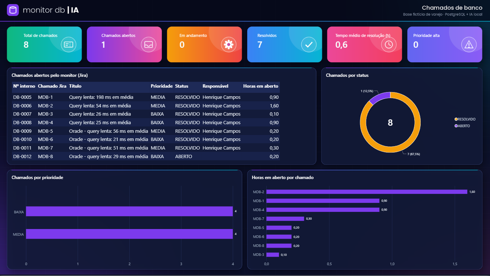

# monitor-db-ia

Monitoramento de bancos de dados com IA, do alerta à correção comprovada.

O lab detecta queries lentas no **PostgreSQL** e no **Oracle**, gera um diagnóstico com IA local,
abre o chamado no **Jira**, avisa o time no **Slack** e, depois que o DBA aprova, cria o índice,
mede o ganho e resolve o chamado sozinho. O histórico vai para o **Databricks**, que prevê quais
queries vão passar do limite aceitável nas próximas semanas.

> Base 100% fictícia (varejo de moda genérico). IA rodando localmente: nenhum dado sai da máquina.



## O ciclo



## Arquitetura



| Componente | Papel |
|---|---|
| PostgreSQL 16 | Base de varejo, `pg_stat_statements`, schemas `monitor` (operação) e `bi` (modelo estrela) |
| Oracle 23ai Free | Mesma base em Oracle, monitorada pelo `V$SQL` e `DBMS_XPLAN` |
| Coletor Oracle (Python) | Lê o top SQL do Oracle, gera o plano e as pistas e grava no monitor |
| n8n | Orquestra análise, alertas, chamados, correções e exportação |
| Ollama (qwen2.5:3b) | IA local e gratuita que escreve o diagnóstico |
| Executor (Python) | Aplica a correção aprovada e mede o ganho real |
| Jira Service Management | Fila de chamados, aprovação e histórico |
| Slack / Telegram | Avisos para o time |
| Databricks | Histórico de performance e previsão (regressão linear) |
| Grafana / Power BI | Painel operacional e relatório gerencial |

## Resultados no lab

**Correções aprovadas e aplicadas automaticamente**

| Chamado | Banco | Antes | Depois | Ganho |
|---|---|---|---|---|
| MDB-2 (vendas das últimas 24h) | PostgreSQL | 53,8 ms | 1,6 ms | 97,1% |
| MDB-3 (divergência de inventário) | PostgreSQL | 26 ms | 0,05 ms | 99,8% |
| MDB-1 (top 20 SKUs do mês) | PostgreSQL | 198 ms | ~196 ms | ~1% (índice não resolve; ver abaixo) |
| MDB-7 (top SKUs) | Oracle | 51 ms | criado com `ONLINE` | - |

O MDB-1 é proposital no relato: o ganho medido mostra que índice não resolve essa query. A correção
certa foi de modelagem, uma tabela pré-agregada atualizada pelo n8n (235 ms para 0,04 ms).

**Previsão no Databricks**

Com o histórico, cada query recebe uma tendência (ms por dia) e o número de dias até passar de 150 ms,
o limite de prioridade ALTA. Os dias anteriores à coleta real são simulados e marcados como `SIMULADO`.

## Por que a IA acerta

Um modelo pequeno, sozinho, sugere índices inúteis. Aqui a IA não adivinha:

1. O próprio banco lê o plano de execução e aponta leitura completa (Seq Scan / TABLE ACCESS FULL)
   em tabela grande, colunas de filtro sem índice e os índices candidatos (`monitor.fn_pistas` e o
   coletor Oracle).
2. A IA recebe essas pistas como verdade e só explica, justifica e avalia o risco.
3. O executor mede o ganho real antes de o chamado ser resolvido.

## Segurança

- Nada é aplicado sem aprovação do DBA no Jira.
- Índices criados sem travar escrita: `CONCURRENTLY` (PostgreSQL) e `ONLINE` (Oracle).
- O executor só existe na rede interna do Docker (sem porta publicada).
- Monitoramento com usuários somente leitura; segredos ficam no `.env` e nas credenciais do n8n (fora do Git).

## Como subir

1. Copie `.env.example` para `.env` e defina as senhas (somente letras e números).
2. Suba o lab:
   ```
   docker compose up -d
   docker compose --profile carga up -d carga
   docker exec -it ollama ollama pull qwen2.5:3b
   ```
3. Oracle (opcional, cerca de 2 GB de RAM):
   ```
   docker compose --profile oracle up -d
   docker exec oracle-lab bash /container-entrypoint-initdb.d/02_monitor.sh
   ```
4. Scripts que rodam em banco já existente: `db/init/04` a `13` (`docker exec postgres-lab psql -U labadmin -d lab -f /docker-entrypoint-initdb.d/<arquivo>`).
5. Importe os fluxos de `n8n/workflows` em http://localhost:5678 e configure as credenciais.
6. Databricks: rode `databricks/01_setup.sql` e `02_previsao.sql` e importe `painel-monitor-db.lvdash.json`.
7. Power BI: siga `docs/powerbi/README.md`.

## Fluxos do n8n

| Fluxo | Frequência | O que faz |
|---|---|---|
| analisador-queries-ollama | 30 min | Top queries lentas do PostgreSQL + plano + pistas -> IA |
| analisador-queries-oracle | 30 min | O mesmo para o Oracle |
| alertas-telegram | 15 min | Envia os diagnósticos no Telegram |
| chamados-jira | 15 min | Abre o chamado no Jira e avisa no Slack com o link |
| sincronizar-jira | 15 min | Traz status e responsável do Jira para o banco |
| aplicar-correcoes | 5 min | Aplica correções aprovadas, mede, comenta e resolve |
| atualizar-preagregados | 1 h | Atualiza a tabela pré-agregada de ranking de SKUs |
| exportar-databricks | 1 h | Snapshot de performance e envio ao Databricks |

## Telas

| | |
|---|---|
|  |  |
|  |  |
|  |  |

## Estrutura

```
db/init/        PostgreSQL: base, monitor, pistas, benchmark, BI, chamados, Jira, Oracle, correções, histórico
oracle/init/    Oracle: base de varejo e usuário de monitoramento
scripts/        cargas, coletor Oracle, executor, aplicação/reversão de índices
n8n/workflows/  fluxos do n8n (os com dados do ambiente ficam em local/, fora do Git)
grafana/        datasource e painel provisionados
databricks/     tabelas, previsão e painel
docs/           Power BI, roteiro de apresentação e imagens
```

## Próximos passos

- Trocar o Ollama pela API do Claude (melhor diagnóstico, mesmo fluxo).
- Alertas no Microsoft Teams, canal mais comum em clientes.
- Piloto em homologação, com usuário de leitura e aprovação de segurança.
